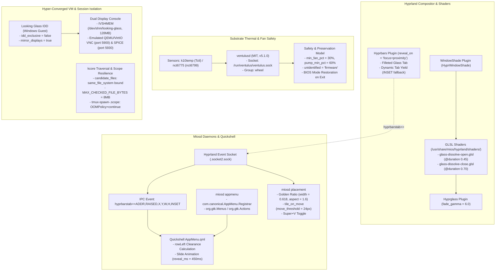

<!-- AI-hint: Chapter 89: Glass Desktop, Liquid Shell Controls, Hyper-Converged VM Display Mirroring, and Session Resilience. Covers Hyprland windowshade shaders, per-window glass controls and interior fallbacks, miosd appmenu registrar pills, float-first placement geometry, ventulusd fan safety, Looking Glass IDD dual mirroring, and tmux OOM scope resilience. -->

# Chapter 89: Glass Desktop, Liquid Shell Controls, and Session Resilience

> Part VIII: Substrate Daemons, Resilient Clustering & Hardware Acceleration of the [MiOS manual](../manual.md).

This chapter documents the graphics shaders, liquid shell controls, window management geometry, hardware fan safety governors, hyper-converged virtual machine display mirroring, and process scope resilience layers implemented across [`usr/share/mios/hyprland/shaders/`](file:///usr/share/mios/hyprland/shaders/), [`src/mios-rs/miosd/`](file:///src/mios-rs/miosd/), [`usr/share/mios/quickshell/`](file:///usr/share/mios/quickshell/), [`usr/share/mios/windows/mios-looking-glass-idd.ps1`](file:///usr/share/mios/windows/mios-looking-glass-idd.ps1), and [`usr/lib/systemd/user/tmux-spawn-.scope.d/10-mios-oom.conf`](file:///usr/lib/systemd/user/tmux-spawn-.scope.d/10-mios-oom.conf).

### Default graphical sessions

The login choices **MiOS iGPU (default)** and **MiOS dGPU** start the same
Hyprland configuration, Quickshell surfaces and glass effects. The entries in
`/usr/share/wayland-sessions/` call `mios-gen hyprland-session` with an explicit
hardware profile. Device identity and ordering come from
`[desktop.hyprland.hardware_profiles]` in `/usr/share/mios/mios.toml`, with the
usual host and user overrides. A selected GPU must have a matching native DRM
device; a GPU bound to `vfio-pci` for a guest cannot render the host desktop.
Its native-driver boot profile releases it for the dGPU login session.

With `desktop.hyprland.boot_sync.enabled`, selecting either MiOS GPU entry in
GRUB also selects that GPU in the login chooser. The native greeter resolves
`mios.desktop.gpu` before reading session memory. Choosing the other GPU at
login saves its managed GRUB entry and reboots after authentication, so the
driver owns the device before the compositor starts. The selected entry is
also the subsequent GRUB default. Username memory is retained. This requires
administrator authorization for the native boot-selection verb; it never
rebinds a live GPU. Both greeter implementations use the same boot profile.

The launcher passes the selected GPU to the compositor. The startup hook also
imports `AQ_DRM_DEVICES`, `WLR_DRM_DEVICES`, `DRI_PRIME` and
`MIOS_DESKTOP_HARDWARE_PROFILE` into the user service manager so Quickshell and
desktop services use that selection. Logout stops both `mios-desktop.target`
and `graphical-session.target`, releasing the old session's desktop services.

Hyprglass renders the desktop glass material. The MiOS Hypr3DGlass integration
uses `/usr/lib64/mios/hypr3d.so`, declared in `[desktop.hyprland.hypr3d]`, for the
3D view. **Super+G** toggles that view in either GPU session; the chord and enable
switch are exposed in the local configurator. The engine loads on first use,
through `/usr/bin/mios-gen hyprland-3d-toggle`. The helper loads the live plugin
through compositor IPC, then configures and toggles it. The Lua plugin-load API
declares configuration and does not perform this live activation. The helper
reuses its loaded instance after a reload.
An unavailable optional engine leaves the desktop shell usable. The image build uses the existing compositor ABI
hold and `build-hyprland-plugin --name hypr3d` with the tracked MiOS glass patch.

The live desktop wallpaper blends three rectilinear projections in both the
3D background and glass reflections. This preserves its top-down capture
coordinates without collapsing the image at the top and bottom of a sphere
or exposing hard cube-face boundaries. Authored panorama files
retain equirectangular sampling. Mirrored panorama wrapping is off by default;
`desktop.hyprland.hypr3d.config.world.panorama_mirror` controls that explicit
effect for panorama files. The renderer's CTest regression runs the shared GLSL
mapping in an offscreen EGL context and checks orientation, both poles, and
color continuity across projection boundaries using an asymmetric texture.

The session's GPU order must survive shell initialization: `/etc/profile.d/50-mios.sh`
preserves an explicit `MIOS_DESKTOP_HARDWARE_PROFILE` or `AQ_DRM_DEVICES` selection.
An older host override in `/etc/environment.d/60-mios-igpu.conf` can force the
iGPU into every session and should yield to the native launcher. Host udev
overrides must also follow the boot choice: a dGPU assigned `ID_SEAT=seat_vfio`
is skipped by the seat0 compositor even when its native driver is loaded.
The managed host override `/etc/udev/rules.d/61-mios-mutter-primary-gpu.rules`
uses `mios.desktop.gpu` to keep VFIO isolation in the iGPU profile and expose
the native dGPU on seat0 in the dGPU profile. Verify the actual renderer in
compositor startup logs; environment variables alone do not establish which
GPU rendered the desktop.



---

### <a name="89_glass_window_effects"></a>89.1 Glass Window Open/Close Effects & Shader Duration Contract

> Path Reference: `/usr/share/doc/mios/manual.md#89_glass_window_effects`

#### WindowShade Compositor Integration
Window open and close animations in the MiOS desktop are orchestrated by the `HyprWindowShade` plugin, declared under `[desktop.hyprland.windowshade]` in [`usr/share/mios/mios.toml`](file:///usr/share/mios/mios.toml):

```toml
[desktop.hyprland.windowshade]
enabled = true
source_repository = "https://github.com/ManofJELLO/HyprWindowShade.git"
# Upstream policy: no source_revision pin; the build takes source_repository default-branch HEAD per "latest + fail loudly"
patches = ["usr/share/mios/hyprland/patches/windowshade-build.patch"]
path = "/usr/lib64/mios/windowshade.so"
shader_dir = "/usr/share/mios/hyprland/shaders"
open = "glass-dissolve-open"
close = "glass-dissolve-close"
overrides = [
  { name = "mios-fx-pip", match = { title = "^(Picture-in-Picture)$" }, open = "none-open", close = "none-close" },
  { name = "mios-fx-modal", match = { modal = true }, open = "none-open", close = "none-close" },
  { name = "mios-fx-portals", match = { class = "^(xdg-desktop-portal-gtk|xdg-desktop-portal-gnome|org\\.freedesktop\\.impl\\.portal\\..*)$" }, open = "none-open", close = "none-close" },
]
```

When a window maps (`open`), `windowshade` captures the initial surface buffer and executes a one-shot fragment shader. Conversely, upon window destruction (`close`), Hyprland retains the closing window's final render buffer as an off-screen texture while the close shader executes. Transient dialogs, Picture-in-Picture streams, modals, and portal dialogs are exempted via `overrides` using `none-open` and `none-close` to maintain instantaneous responsiveness. Wayland layer-shell surfaces (status bar, application menu, dock, notification toasts) bypass windowshade entirely.

#### The Shader Duration and Palette Contract
Every shader deployed under `/usr/share/mios/hyprland/shaders/` conforms to a strict operational contract:
1. **Duration Annotation (`// @duration <seconds>`)**: HyprWindowShade parses the shader source header to determine animation duration. For example, `glass-dissolve-open.glsl` declares `// @duration 0.45`, whereas `glass-dissolve-close.glsl` declares `// @duration 0.70`. This duration sets the normalized `progress` variable ($0.0 \to 1.0$) passed to the GPU pipeline:
   ```glsl
   #version 320 es
   // @duration 0.45
   precision highp float;
   in vec2 v_texcoord;
   out vec4 fragColor;
   uniform sampler2D tex;
   uniform float progress;
   ```
2. **Palette Token Substitution (`// @palette <key>`)**: Shaders avoid hardcoding static RGB values. Lines annotated with `// @palette <key>` are rewritten dynamically at session login by `mios-theme-render` using the active SSOT color table (`[colors]` in `mios.toml`), generating runtime instances under `$XDG_RUNTIME_DIR/mios-shader-<name>.glsl`:
   ```glsl
   const vec3 MESH_A = vec3(0.157, 0.133, 0.384); // @palette bg
   const vec3 MESH_B = vec3(0.102, 0.251, 0.498); // @palette accent
   const vec3 MESH_C = vec3(0.953, 0.361, 0.082); // @palette cursor
   const vec3 FROST  = vec3(0.718, 0.788, 0.843); // @palette subtle
   ```
3. **Lexer and Parsing Invariant**: Regression tests (`tests/test-hyprland-shader-contract.py`) enforce that every GLSL shader declares a valid `// @duration` directive and contains no premature closing braces (`}`) at column zero prior to the conclusion of `main()`.

#### Optical Interaction with Hyprglass Fade Gamma
A recurring defect in composited glass environments is the "popping box" artifact: as an opening window expands from a point or line, its underlying backdrop blur pane snaps to full size prematurely, revealing an unblurred rectangular footprint. MiOS resolves this through a custom compositor patch (`usr/share/mios/hyprland/patches/hyprglass-fade-gamma.patch`) configuring `[desktop.hyprland.hyprglass.config] fade_gamma = 6.0`:

$$\alpha_{\text{glass}} = (\text{progress})^{\gamma} = (\text{progress})^{6.0}$$

Because the exponent $\gamma = 6.0$ is heavily weighted toward the end of the duration interval:
- At $\text{progress} = 0.50$ (halfway through the open effect), $\alpha_{\text{glass}} = (0.50)^6 = 0.0156$ (less than $1.6\%$ opacity).
- At $\text{progress} = 0.80$, $\alpha_{\text{glass}} = (0.80)^6 \approx 0.262$ ($26.2\%$ opacity).
- At $\text{progress} = 1.00$, $\alpha_{\text{glass}} = 1.00$ ($100\%$ full blur opacity).

This non-linear curve keeps the backdrop glass pane imperceptible while the window's own shader scales outward from the desktop mesh, eliminating rectangular blur popping.

---

### <a name="89_per_window_glass_controls"></a>89.2 Per-Window Glass Controls & Dynamic Tab Yielding

> Path Reference: `/usr/share/doc/mios/manual.md#89_per_window_glass_controls`

#### In-Window Titlebar Elimination
Conventional desktop titlebars occupy 32 to 44 pixels of vertical screen real estate per window, fracturing the continuity of tiled and floating workspaces. MiOS replaces legacy titlebars with overlay controls powered by `hyprbars` (`usr/share/mios/hyprland/patches/hyprbars-overlay.patch`) and configured under `[desktop.hyprland.hyprbars.config]` in [`usr/share/mios/mios.toml`](file:///usr/share/mios/mios.toml):

```toml
[desktop.hyprland.hyprbars.config]
bar_overlay = true
bar_height = 28
bar_color = "rgba(00000000)"
bar_title_enabled = false
bar_buttons_alignment = "left"
bar_padding = 52
bar_button_padding = 8
bar_part_of_window = true
reveal_on = "focus+proximity"
reveal_radius = 48
glass_preset = "mios"
tab_yield = true
yield_layers = "mios-topbar,mios-dock"
pill_enabled = true
pill_blur = true
pill_palette = "bg"
pill_alpha = "theme.opacity"
pill_merge = 6
pill_shadow_comp = true
pill_padding = 9
pill_inset = 3
pill_feather = 6
```

With `bar_overlay = true` and `bar_color = "rgba(00000000)"`, the window's client area extends completely to the top edge. The left inset (`bar_padding = 52`) guarantees that application-native UI elements (such as sidebar toggle icons in browser or editor interfaces) remain unhindered and fully clickable.

#### Optical Formulation of the Glass Pill
The controls reside on a frosted glass tab protruding above the window's top edge. The optical characteristics are derived directly from the active `[desktop.hyprland.hyprglass.presets.mios]` preset:
- **Pill Blur Kernel**: The Gaussian blur standard deviation is calculated from the hyprglass parameters:
  $$\sigma_{\text{pill}} = 4 \times \text{blur\_strength} \times \sqrt{\text{blur\_iterations}}$$
  For preset `mios` ($\text{blur\_strength} = 0.25$, $\text{blur\_iterations} = 2$):
  $$\sigma_{\text{pill}} = 4 \times 0.25 \times \sqrt{2} \approx 1.414\text{ device pixels}$$
- **Contour Filleting and Shadow Division**: Concave fillets join the protruding tab to the top window edge. With `pill_shadow_comp = true`, the compositor divides the window's drop shadow out of the backdrop texture sampled behind the tab, ensuring the glass does not darken when overlapping its own shadow.
- **Surface Merging**: With `pill_merge = 6`, the frosted glass boundary extends 6 pixels downward into the top edge of the window, fading out smoothly so the tab and window read as a single sculpted optical element.

#### Reveal Triggers and Dynamic Tab Yielding
The control tab does not permanently clutter the desktop. Under `reveal_on = "focus+proximity"`, the tab is raised only when the window holds keyboard focus **and** the pointer moves within `reveal_radius = 48` pixels of the tab area.

The tab's spatial placement adapts dynamically to desktop layout constraints via `tab_yield = true`:
1. **Normal Protruding Tab**: If space permits, the tab rises above the window's top-left edge ($y_{\text{tab}} < y_{\text{window}}$).
2. **Dynamic Interior Fallback (`INSET = 1`)**: If protruding above the window would:
   - Overlap an active layer-shell surface declared in `yield_layers = "mios-topbar,mios-dock"` (e.g. the top status island or bottom dock),
   - Extend beyond the physical monitor boundary (screen top margin), or
   - Sit underneath an overlapping neighbor window with higher z-order,
   the tab automatically yields and renders *inside* the window's top-left corner as an interior floating overlay (`INSET = 1`).
3. **Fullscreen Drop-In**: Fullscreen windows always receive the inset configuration. Moving the pointer to the top edge slides the inset tab down into the window on the compositor's `fadeIn` curve, granting immediate access to window management controls without exiting fullscreen mode.

---

### <a name="89_topbar_appmenu_pills"></a>89.3 Top-Bar App-Menu Pills & IPC Slide Animation

> Path Reference: `/usr/share/doc/mios/manual.md#89_topbar_appmenu_pills`

#### Menu Aggregation Architecture (`miosd appmenu`)
Application menu bars (File, Edit, View, Window, Help) are extracted and displayed as responsive pills in the top status bar. The daemon [`src/mios-rs/miosd/src/appmenu.rs`](file:///src/mios-rs/miosd/src/appmenu.rs) runs as a user systemd service (`mios-appmenu.service`), tracking Hyprland focus over the compositor event socket:

```
[Focused Application]
     │
     ├── GTK / GApplication ──> D-Bus Session Bus (org.gtk.Menus / org.gtk.Actions)
     │
     └── Qt / XWayland / Gecko ─> com.canonical.AppMenu.Registrar (/com/canonical/AppMenu/Registrar)
                                         │
                                         ▼
                            [miosd appmenu Daemon]
                                         │
                                         ▼ Atomic Write
                         $XDG_RUNTIME_DIR/mios/appmenu.json
                                         │
                                         ▼ QML File Watcher
                         [usr/share/mios/quickshell/AppMenu.qml]
```

1. **GTK Native Applications**: `miosd` queries `org.gtk.Menus` and `org.gtk.Actions` under the application's well-known D-Bus name or process connection.
2. **Qt and XWayland Applications**: `miosd` acts as the D-Bus registrar for `com.canonical.AppMenu.Registrar`, handling window registrations emitted by Qt applications and `appmenu-gtk-module`.
3. **Atomic Export**: Menus are normalized into a unified JSON hierarchy and written atomically to `$XDG_RUNTIME_DIR/mios/appmenu.json`.

#### Live Tab IPC and Quickshell Slide Animation
When a window's glass control tab protrudes into the top-bar region, it risks visually colliding with the top-bar application menu pills. To prevent this, `hyprbars` emits real-time tab state events over Hyprland's socket2 interface:

$$\texttt{hyprbarstab>>ADDRESS,RAISED,X,Y,W,H,INSET}$$

In [`usr/share/mios/quickshell/AppMenu.qml`](file:///usr/share/mios/quickshell/AppMenu.qml), the top bar listens for `hyprbarstab` events:
```qml
function onTabEvent(data) {
    const f = String(data).split(",")
    if (f.length < 7) return
    const next = Object.assign({}, tabs)
    if (f[1] === "1" && f[6] === "0") next[f[0]] = { x: +f[2], y: +f[3], w: +f[4], h: +f[5] }
    else delete next[f[0]]
    tabs = next
}
```

Only tabs that are currently raised (`RAISED = 1`) and protruding (`INSET = 0`) trigger layout recalculation. If a tab yields to the interior (`INSET = 1`), `f[6]` is non-zero, leaving the top-bar row untouched.

When an external tab protrudes, `rowLeft` calculates the necessary clearance past the tab's right edge (`t.x + t.w - m.x`) plus layout margins. The menu pills smoothly slide rightward using an animated cubic easing transition:
```qml
property real shownLeft: rowLeft
Behavior on shownLeft {
    NumberAnimation {
        duration: menus.tab.reveal_ms !== undefined ? menus.tab.reveal_ms : 450
        easing.type: Easing.OutCubic
    }
}
```
When the pointer departs the window tab area, `RAISED` flips to `0`, and the menu pills glide back to their home position.

#### Flatpak Sandboxed Browser Integration (`Zen Browser`)
Modern browsers distributed as Flatpaks (such as Zen Browser, `app.zen_browser.zen`) execute in isolated mount namespaces lacking native D-Bus menu modules. MiOS bridges this in `[browser.zen]` (`usr/share/mios/mios.toml:4530-4537`):
- Sets `widget.gtk.global-menu.enabled = true` and `widget.gtk.global-menu.wayland.enabled = true` inside the browser's `user.js` profile.
- Binds host copies of `libdbusmenu-glib` and `libdbusmenu-gtk3` into `~/.var/app/app.zen_browser.zen/mios-dbusmenu/` via Flatpak filesystem overrides.
- Injects a per-user `LD_LIBRARY_PATH` wrapper, enabling sandboxed Gecko/Zen instances to export menubars to `miosd` and render top-bar pills identically to native host software.

---

### <a name="89_float_first_window_placement"></a>89.4 Float-First Window Placement & Automated Tiling

> Path Reference: `/usr/share/doc/mios/manual.md#89_float_first_window_placement`

#### The Float-First Paradigm
Traditional tiling window managers force new windows into immediate tiling splits, fracturing active workspace layouts and resizing existing editor or terminal views. MiOS adopts a **float-first placement architecture** implemented in [`src/mios-rs/miosd/src/placement.rs`](file:///src/mios-rs/miosd/src/placement.rs) and configured in `[desktop.hyprland.placement]` in [`usr/share/mios/mios.toml`](file:///usr/share/mios/mios.toml):

```toml
[desktop.hyprland.placement]
enabled = true
scope = "all"
width_ratio = 0.618
aspect = 1.6
min_width_px = 640
min_height_px = 400
max_width_px = 1800
max_width_ratio = 0.9
max_height_ratio = 0.9
max_width_mm = 420
tile_on_move = true
move_threshold_px = 24
settle_ms = 220
poll_ms = 100
size_tolerance_px = 4
open_tag = "mios-place-new"
managed_tag = "mios-placed"
```

#### Mathematical Geometry Formulation
When a new client maps, `miosd placement` calculates ergonomic window bounds relative to usable monitor dimensions ($W_{\text{usable}} = W_{\text{monitor}} - 2 \cdot \text{margin}$):

$$W_{\text{calc}} = \text{clamp}(W_{\text{usable}} \cdot \text{width\_ratio},\ \text{min\_width\_px},\ \min(\text{max\_width\_px},\ W_{\text{usable}} \cdot \text{max\_width\_ratio}))$$

$$H_{\text{calc}} = \text{clamp}\left(\frac{W_{\text{calc}}}{\text{aspect}},\ \text{min\_height\_px},\ H_{\text{usable}} \cdot \text{max\_height\_ratio}\right)$$

Where:
- $\text{width\_ratio} = 0.618$ (the Golden Ratio conjugate), providing an optimal balance of focal attention and background spatial awareness.
- $\text{aspect} = 1.6$ (16:10 proportion), ideal for modern code editors and documents.
- $\text{max\_width\_mm} = 420$: On high-resolution ultra-wide displays (e.g. 49-inch 32:9 monitors), windows are constrained by physical panel width in millimeters, preventing over-extended text lines.

#### Window Tagging and Drag-to-Tile Lifecycle
1. **Initial Tagging**: Compositor window rules tag newly spawned windows with `open_tag = "mios-place-new"` and center them as floating surfaces.
2. **Adoption**: The `miosd placement serve` loop detects the window over the Hyprland event socket, verifies that rule sizing completed, applies monitor-specific geometry, and assigns `managed_tag = "mios-placed"`.
3. **Automated Tiling on Drag (`tile_on_move = true`)**:
   - The daemon polls managed windows. When an operator clicks and drags a managed window beyond `move_threshold_px = 24`, the daemon begins position tracking.
   - Using direct Linux evdev event queries (`EVIOCGKEY`) on pointer input devices, the daemon monitors mouse button release.
   - Once the pointer settles for `settle_ms = 220` with no mouse buttons depressed and window dimensions unaltered ($\le \text{size\_tolerance\_px}$), the daemon unsets the floating flag (`hyprctl dispatch settiled`). The window drops into Hyprland's tiling layout at the drop target.
4. **Exemption Invariant**: Dialogs, modals, Picture-in-Picture windows, and surfaces manually floated or resized by the operator are excluded from `managed_tag` and are never tiled automatically.
5. **Operator Hotkey**: Pressing `Super+V` invokes `miosd placement toggle`, switching the focused window between its calculated golden-ratio floating geometry and its tiled layout position.

---

### <a name="89_fan_control_safety_model"></a>89.5 Fan Control Safety Model & Firmware Preservation

> Path Reference: `/usr/share/doc/mios/manual.md#89_fan_control_safety_model`

#### Daemon Selection & Licensing Compliance
Hardware fan control in MiOS is managed by `ventulusd` under `[hardware.fan_control]` in [`usr/share/mios/mios.toml`](file:///usr/share/mios/mios.toml):

```toml
[hardware.fan_control]
enabled          = true
tool             = "ventulusd"
version          = "v5.1.0"
license          = "MIT"
service          = "ventulusd.service"
client           = "mios-fanctl"
modules          = ["nct6775"]
profile          = "mios-default"
socket           = "/run/ventulus/ventulus.sock"
socket_group     = "wheel"
poll_interval_ms = 1000
min_fan_pct      = 30
pump_min_pct     = 60
unidentified     = "firmware"
coolant_limit_c  = 60
exit_floor_pct   = 50
cpu_sensor       = "hwmon:k10temp:0000:00:18.3:Tctl"
curve            = [[40, 30], [55, 31.5], [65, 38.5], [75, 52.5], [85, 70], [90, 100]]
```

Common Linux fan utilities (`fan2go`, `CoolerControl`, `fancontrol`, `thinkfan`) carry copyleft (GPL) licenses that violate MiOS system integration policies. `ventulusd` is MIT-licensed, lightweight, and supports hardware Super I/O chips (including Nuvoton NCT6799D via the `nct6775` kernel driver). The Unix control socket `/run/ventulus/ventulus.sock` is restricted to `socket_group = "wheel"`, closing upstream security vulnerabilities associated with world-writable daemon sockets.

#### Firmware Preservation Architecture
A core engineering principle of MiOS hardware governance is that software must never endanger silicon stability:
1. **Selective Takeover (`unidentified = "firmware"`)**: The daemon only assumes control over channels explicitly declared with `control = "curve"`. Any unlisted fan header or unrecognized device remains untouched under the native motherboard UEFI/BIOS hardware curve.
2. **Liquid Cooling Pump Protection**: Dedicated pump headers (`role = "pump"`, e.g. AIO pump and `W_PUMP+`) are permanently locked to `control = "firmware"` at 100% duty cycle (`pwm6`, `pwm7`), preventing pump stalls and catastrophic coolant boiling.
3. **Restoration on Termination**: Prior to modifying any hardware PWM register, `ventulusd` records the original BIOS control registers. On graceful daemon termination, process crash (`ExecStopPost`), or crash recovery replay (`ExecStartPre`), the recorded BIOS configuration is restored to the Super I/O controller.

#### Thermal Curves and Safety Clamping
Thermal regulation is governed by piecewise linear interpolation across configured temperature setpoints:

| Temperature Range | Duty Cycle | Operating Characteristic |
| :--- | :--- | :--- |
| $\le 40^\circ\text{C}$ | $30.0\%$ | Acoustic idle floor ($\text{min\_fan\_pct} = 30$) |
| $55^\circ\text{C}$ | $31.5\%$ | Whisper-quiet desktop baseline |
| $65^\circ\text{C}$ | $38.5\%$ | Moderate compilation and reasoning load |
| $75^\circ\text{C}$ | $52.5\%$ | High sustained compute throughput |
| $85^\circ\text{C}$ | $70.0\%$ | Elevated thermal dissipation curve |
| $\ge 90^\circ\text{C}$ | $100.0\%$ | Full emergency fan speed |

The curve enforces a 3°C hysteresis to prevent fan hunting. By ramping to $100\%$ fan speed at $90^\circ\text{C}$, the fan safety governor ensures maximum heat rejection well before silicon reaches hardware thermal shutdown limits ($95^\circ\text{C} - 105^\circ\text{C}$).

---

### <a name="89_looking_glass_idd_mirroring"></a>89.6 Looking Glass IDD & Dual VNC/SPICE Display Mirroring

> Path Reference: `/usr/share/doc/mios/manual.md#89_looking_glass_idd_mirroring`

#### Hyper-Converged VM Display Topology
MiOS virtual machine gaming and compute acceleration (such as `mios-xbox-current`) leverage Looking Glass over shared memory IVSHMEM, configured in `[vm.looking_glass]` in [`usr/share/mios/mios.toml`](file:///usr/share/mios/mios.toml):

```toml
[vm.looking_glass]
enabled            = true
domains            = ["mios-xbox-current", "Xbox"]
connect            = "qemu:///system"
threads_per_core   = 2
topoext            = true
clock_offset       = "localtime"
spice_listen       = "127.0.0.1"
spice_port         = 5930
vnc_console        = true
vnc_listen         = "127.0.0.1"
idd_exclusive      = false
mirror_displays    = true
spice_audio        = true
spice_channel      = "com.redhat.spice.0"
sound_model        = "ich9"
shm_name           = "looking-glass"
shm_path           = "/dev/shm/looking-glass"
shm_size_mb        = 128
shm_selinux_type   = "svirt_tmpfs_t"
client             = "/usr/bin/looking-glass-client"
client_ini         = "/etc/looking-glass-client.ini"
client_auto_resize = false
start_timeout_s    = 120
```

Frames are transported from guest VRAM to host RAM through an IVSHMEM device located at `/dev/shm/looking-glass` (128 MB), labeled with SELinux context `svirt_tmpfs_t` to allow secure QEMU access.

#### Non-Exclusive IDD Invariant (`idd_exclusive = false`)
A critical configuration invariant is `idd_exclusive = false`. When upstream Looking Glass Indirect Display Driver (IDD) is installed with exclusive mode enabled, it disables all secondary and virtual display adapters within the Windows guest. 

In MiOS, disabling the secondary adapters would extinguish the emulated QEMU/VirtIO display adapter. By mandating `idd_exclusive = false`:
- The emulated VirtIO graphics adapter remains permanently enabled.
- A native VNC console (`vnc_console = true`, port 5900) and SPICE socket (`127.0.0.1:5930`) remain continuously reachable on the host.
- Administrators can connect to the guest graphical console via Cockpit or `virt-manager` during boot phases, Windows logon, system updates, and recovery environments when Looking Glass capture is not yet running.

#### Automated Display Mirroring (`mirror_displays = true`)
To prevent multi-monitor desktop extension confusion—where windows or cursors become trapped on off-screen virtual adapters—the guest provisioning script [`usr/share/mios/windows/mios-looking-glass-idd.ps1`](file:///usr/share/mios/windows/mios-looking-glass-idd.ps1) mandates display cloning:

```powershell
param(
    [Parameter(Mandatory = $true)][string]$Url,
    [Parameter(Mandatory = $true)][string]$Sha256,
    [Parameter(Mandatory = $true)][string]$Version,
    [string]$Signer = 'CN=HostFission',
    [int]$ExclusiveMonitor = 0,
    [int]$MirrorDisplays = 1,
    [switch]$Force
)
```

During Windows user sign-in, the guest configuration executes `SetDisplayConfig` or `DisplaySwitch.exe /clone` to establish a `Duplicate` display topology. Consequently:
1. Looking Glass IDD captures the rendered desktop at low latency.
2. The emulated VirtIO console (VNC / SPICE) mirrors the exact same desktop.
3. Physical discrete GPU outputs (if connected) display the identical frame buffer.

Whether the operator views the virtual machine via `looking-glass-client`, Cockpit web VNC, or physical hardware display, the visual experience remains perfectly synchronized.

---

### <a name="89_kernel_traversal_oom_resilience"></a>89.7 Kernel Memory Traversal OOM & Tmux Scope Resilience

> Path Reference: `/usr/share/doc/mios/manual.md#89_kernel_traversal_oom_resilience`

#### Root Cause Analysis: The `/proc/kcore` Traversal Defect
In MiOS, the Git repository root is the deployed system root overlay (`.git` IS `/`). While this enables atomic self-development and live system rebuilds, it introduces subtle edge cases when developer tools perform recursive directory traversals.

The tool `mios-template-conform` ([`tools/native/mios-template-conform/src/main.rs`](file:///tools/native/mios-template-conform/src/main.rs)) verifies template conformity and header metadata across all repository source files. During a validation run executed against `--root /`, the directory walker traversed into Linux virtual filesystems:
1. It crossed into `/proc/` and opened `/proc/kcore`. In Linux, `/proc/kcore` is a dynamic ELF core file representing the entirety of physical RAM and virtual kernel address space (often 32 GB to 128 GB or more).
2. It simultaneously traversed into `/var/lib/libvirt/images/`, attempting to parse multi-gigabyte raw virtual machine disk images as UTF-8 source text.
3. Heap allocation ballooned instantaneously to 34 GB, exhausting available host RAM and triggering the Linux kernel Out-Of-Memory (`out_of_memory`) killer.

#### Cascading Failure: Systemd Scope Termination
Under standard systemd user session semantics, terminal panes spawned within tmux run under dynamically generated user scopes matching `tmux-spawn-.scope`. By default, systemd user scopes operate with:

```ini
OOMPolicy=stop
```

When `mios-template-conform` exhausted system memory and was terminated by `SIGKILL` from the kernel OOM killer, systemd detected an OOM event within the scope. Under `OOMPolicy=stop`, systemd tore down the entire `tmux-spawn-.scope` unit. This immediately killed the parent bash shell, the tmux pane, and every adjacent background task running within the pane, causing widespread operator session loss.

#### Two-Sided Engineering Resolution
MiOS resolved this vulnerability at both the application and systemd architecture layers:

1. **Filesystem Containment and Size Bounds in `mios-template-conform`**:
   [`tools/native/mios-template-conform/src/main.rs`](file:///tools/native/mios-template-conform/src/main.rs) was hardened with strict filesystem boundaries:
   ```rust
   // Never read the whole operating system: candidate_files stays within the repository (or the
   // root's filesystem), and only regular files a template governs are read, within a size bound.
   // Reading /proc/kcore or VM images whole once drove this tool to 34 GB and got the operator's
   // session OOM-killed.
   for p in candidate_files(root_path, &ignore_dirs) {
   ```
   - Traversals are restricted to the same device filesystem (`same_file_system`), automatically skipping `/proc`, `/sys`, `/dev`, and mounted network shares.
   - Enforces an absolute size ceiling: `MAX_CHECKED_FILE_BYTES = 8 * 1024 * 1024` (8 MB). Files exceeding 8 MB are immediately classified as non-conforming without reading their contents into memory.
   - A regression test (`walk_reads_only_governed_files_within_the_size_bound()`) asserts that 4 GiB sparse files and virtual images are never loaded.

2. **Tmux Scope Resilience Drop-In (`10-mios-oom.conf`)**:
   [`usr/lib/systemd/user/tmux-spawn-.scope.d/10-mios-oom.conf`](file:///usr/lib/systemd/user/tmux-spawn-.scope.d/10-mios-oom.conf) configures systemd to isolate OOM events:
   ```ini
   # AI-hint: Keeps a tmux pane (and the tmux session around it) alive when one process inside it is OOM-killed: only that process dies, not the whole pane scope.
   # AI-related: usr/lib/systemd/user/vte-spawn-.scope.d/defaults.conf, usr/share/mios/mios.toml [terminal]
   # A runaway tool once grew to 34 GB inside an agent pane; the default OOMPolicy=stop then tore down
   # the whole tmux pane scope and the operator lost every session in it.
   [Scope]
   OOMPolicy=continue
   ```

With `OOMPolicy=continue`, if a runaway compiler, language model, or build script triggers an OOM event, the Linux kernel terminates only that offending child process. The scope remains healthy, the parent shell stays responsive, and the developer's tmux session is preserved without interruption.


---

### <a name="89_desktop_hardware_profiles"></a>89.8 Desktop Hardware Profiles

The login choices `MiOS-Desktop (default iGPU)` and `MiOS-Desktop dGPU (NVIDIA)`
use the same Hyprland configuration, Quickshell and `mios-desktop.target`.
Only the selected hardware profile and DRM device order differ. Their generated
desktop entries live in `/usr/share/wayland-sessions/`; the launcher is
`/usr/bin/mios-gen hyprland-session`.

The SSOT tables are `[desktop.hyprland.hardware_profiles.igpu]` and
`[desktop.hyprland.hardware_profiles.dgpu]`. Each declares its desktop-file
name, visible name, PCI identity or identity file, DRM alias and whether to
include other DRM devices after the selected GPU. PCI identity takes precedence
over the alias. A missing requested GPU fails with an error; it does not silently
select another GPU.

An explicit login choice (`--hardware-profile`) takes precedence over the
`mios.desktop.gpu=` kernel argument. Without either, the launcher uses
`desktop.hyprland.hardware_profile`, whose vendor default is `igpu`.
A remembered iGPU login choice therefore still starts the iGPU desktop after a
dGPU boot. Select the dGPU login choice to render that desktop on the dGPU.

For existing hosts using BLS type-1 entries, generate the two hardware boot
choices from the installed kernel entry:

```sh
mios-gen render-hyprland --boot-entry /boot/loader/entries/<existing-kernel-entry>.conf
mios-gen render-hyprland --boot-entry /boot/loader/entries/<existing-kernel-entry>.conf --check
mios-gen hyprland-session --hardware-profile dgpu --dry-run
```

The generator retains the source kernel, initrd, root filesystem and remaining
kernel options. Profile `boot_remove` and `boot_append` arrays describe only
the hardware differences. It refuses to replace boot entries it did not generate.
An explicit `--root` reads that root's vendor TOML, so staging and review do not
read the builder's installed configuration.

Signed UKI entries are rejected: their hardware command lines must be built and
signed through the image pipeline. The BLS generator does not modify signed UKIs.

A whole GPU assigned to a VM cannot also render the host desktop. The iGPU boot
profile retains VFIO reservation for the guest. On the development host, the dGPU
boot profile instead loads the available Nouveau driver; it does not install a
proprietary driver. Changing the login choice does not detach a running VM's GPU
or change driver ownership. Boot the appropriate hardware profile before login.

VRR is configured through `[desktop.hyprland.config.misc] vrr` and requires an
enabled adaptive-sync output. Confirm the live output with `hyprctl monitors -j`.
A guest compositor frame-rate measurement does not establish Looking Glass
delivery rate; verify the existing viewer's image, cursor movement and frame
statistics separately.
